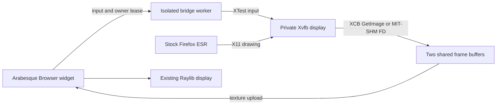
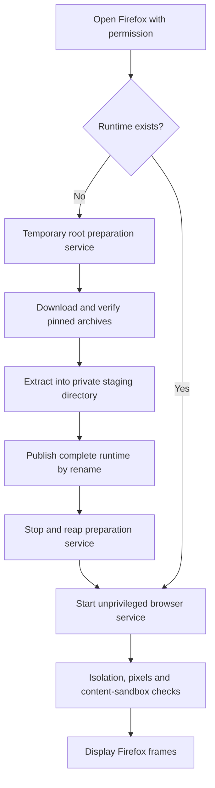

# Firefox in Arabesque

A fully local Firefox browser for the large StarPilot UI on comma 3/3X. Firefox keeps its own tabs, address bar, menus and browser dialogs; Arabesque supplies the pane, touch controls and on-screen keyboard.

**Normal use requires no terminal commands or manual runtime installation.** Open **Settings → Developer → Arabesque → Firefox** while off-road. First use prepares the private browser bundle automatically and shows progress. Later opens reuse it; a newer bundle approved in StarPilot produces an **Update Firefox / Later** offer before Firefox starts.

| Property | Implementation |
| --- | --- |
| Target platform | ARM64 AGNOS `19.8.1`; physical comma 3 tested; comma 3X qualification remains open |
| Pinned browser | Official Mozilla Firefox ESR `153.6.0esr`; exact artifacts in [runtime.json](runtime.json) |
| Browser execution | Firefox and Xvfb run on the comma itself |
| Display | Private Xvfb framebuffer → XCB capture → shared memory → Raylib texture |
| Installation scope | Application files under `/data/arabesque-firefox`; no OS package installation |
| First-use download | Approximately **75.6 MiB**, comprising Firefox and nine runtime packages |
| Closed behavior | No Firefox, Xvfb, capture worker or preparation service remains after teardown |
| Persistent data | Private browser profile, downloads, cache and verified installation archives |
| Availability | Off-road only; opening, continued use and input remain permission-gated |

## Contents

- [Using Firefox](#using-firefox)
- [Why this architecture](#why-this-architecture)
- [Source map](#source-map)
- [How the implementation was developed](#how-the-implementation-was-developed)
- [Automatic first-use preparation](#automatic-first-use-preparation)
- [On-demand browser updates](#on-demand-browser-updates)
- [The browser runtime](#the-browser-runtime)
- [Capturing and displaying frames](#capturing-and-displaying-frames)
- [Touch and keyboard input](#touch-and-keyboard-input)
- [Isolation and security boundaries](#isolation-and-security-boundaries)
- [On-demand lifecycle and failure handling](#on-demand-lifecycle-and-failure-handling)
- [Resource limits and persistent files](#resource-limits-and-persistent-files)
- [Validation and measured results](#validation-and-measured-results)
- [Developer diagnostics and tests](#developer-diagnostics-and-tests)
- [Troubleshooting](#troubleshooting)
- [Maintenance and remaining work](#maintenance-and-remaining-work)

## Using Firefox

1. While parked and off-road, open **Settings → Developer → Arabesque → Firefox**.
2. On first use, allow the browser download and preparation to finish. The pane displays download percentages and preparation progress. Internet access and at least **6 GiB free on `/data`** are required for preparation.
3. Handle Firefox's normal welcome and terms/privacy prompt, then browse using its own interface.
4. Use **Desktop** to close Firefox and return to the Arabesque dock. Reopening restores the saved profile and requests session restoration.

The first-use download runs only after opening the tool. Closing the tool, sleeping the display, covering Arabesque with another active widget, losing off-road permission or exiting the UI stops the active session, including preparation. Verified package downloads are retained for a later attempt; an interrupted archive must download again. Preparation does not resume in the background.

| Control | Behavior |
| --- | --- |
| **Keyboard** | Show or hide the local on-screen keyboard |
| **Address** | Focus Firefox's address bar with Ctrl+L and show the keyboard |
| **Scroll** | Tap to click; drag vertically to scroll; long-press to right-click |
| **Pointer** | Send ordinary press/move/release events for dragging and selection |
| **Up / Down** | Pan the visible browser area while the keyboard is open |
| **Desktop** | Close the browser session and return to the dock |

The keyboard crops the visible browser area rather than shrinking the page. A page therefore retains the same readable scale while typing.

**The commands later in this document are developer diagnostics. Users do not need to run `setup.py`, reference capture or SHM checks before browsing.** Capture qualification and runtime checks happen automatically when the browser starts.

## Why this architecture

Arabesque is a desktop-style shell drawn inside StarPilot's Raylib application. On the target, Raylib owns the physical display through the comma graphics backend. It does not provide the X11 desktop or Firefox embedding interface that a conventional desktop browser expects.

The implementation supplies Firefox with a private virtual display and brings that display into an ordinary Arabesque widget:



Xvfb is an X server whose screen lives in memory. Firefox can use its normal GTK/X11 application without taking over the physical display. The bridge captures the complete virtual root window, including browser chrome and visible popup windows.

This keeps Firefox's existing browser product intact. There is no custom Gecko build, replacement browser navigation interface, external browser machine, VNC/RFB layer or image/video encoder in the frame path. The bridge itself has no TCP listener. Firefox still makes ordinary network requests for websites, and first-use preparation downloads its pinned application bundle.

Firefox renders in software in this configuration. Raylib uses its existing GPU path to upload, scale and draw the captured image. These are separate stages: displaying a texture with the GPU does not imply accelerated Firefox video decoding or WebGL.

## Source map

| File | Responsibility |
| --- | --- |
| [setup.py](setup.py) | Shared bundle validation/building, first installation, durable update/restore journal and application activation |
| [runtime.json](runtime.json) | Bundle format/revision, Firefox version, AGNOS target, archive URLs, exact sizes and pinned digests |
| [browser.py](../../selfdrive/ui/layouts/arabesque/tools/browser.py) | Arabesque widget, update/restore choices, keyboard, gestures, texture upload and color shader |
| [browser_session.py](../../selfdrive/ui/layouts/arabesque/tools/browser_session.py) | Session ownership, preparation/update controller, independent profile/qualification jobs, isolation and capture |
| [browser_x11.py](../../selfdrive/ui/layouts/arabesque/tools/browser_x11.py) | Small native XCB binding for pixel/paint/title checks, capture, damage, focus and input |
| [desktop.py](../../selfdrive/ui/layouts/arabesque/desktop.py) | Firefox dock entry and active-tool lifecycle |
| [layouts/main.py](../../selfdrive/ui/layouts/main.py) | Permission checks and pause/revocation handling for Arabesque |
| [ui.py](../../selfdrive/ui/ui.py) | Poll the Arabesque runtime after fresh UI state, including frames where drawing is skipped |
| [test_setup.py](test_setup.py), [test_update.py](test_update.py), [test_capture.py](test_capture.py) | Installer integrity, filesystem transactions/profile preservation, interruption and opt-in native Xvfb tests |
| [test_arabesque_browser.py](../../selfdrive/ui/tests/test_arabesque_browser.py) | Protocol, preparation, lifecycle, input, shared-buffer and GPU regressions |

All helper processes use the Python standard library. Native XCB calls use `ctypes`; the implementation adds no Python browser automation or embedding dependency.

## How the implementation was developed

The work proceeded through independently checkable stages:

1. **Establish the actual platform.** Inspect StarPilot's UI, the sibling AGNOS builder and manifest-matched AGNOS artifacts. The older sibling builder was historical context; its desktop assumptions were not treated as proof about the current image.
2. **Close the browser's runtime dependencies.** Use the official ARM64 Firefox archive and a small private set of Ubuntu libraries, retaining the installed OS libraries and graphics stack.
3. **Prove the simple capture path first.** Draw known colors into Xvfb and verify ordinary GetImage pixels before relying on shared-memory capture.
4. **Qualify the faster path against that reference.** Attach sealed memfds through MIT-SHM 1.2, capture the same screen and compare the complete frames before launching Firefox.
5. **Integrate through existing widget lifecycles.** Reuse Arabesque's active-tool ownership and the application's render-prepare hook. Keep capture work outside the UI process and GPU upload on the UI thread.
6. **Test on physical hardware.** Validate isolation, actual Firefox content seccomp, both capture modes, the Raylib texture path, touch/input and independent cleanup. Fix assumptions exposed by the target's older kernel.
7. **Remove the manual first-use dependency.** Add supervised preparation to the session itself. A first open now downloads and prepares the bundle, hands off to the unprivileged runtime and launches Firefox automatically.

The physical trials mattered. Several Linux/systemd options behaved differently from an ordinary development machine; the resulting checks and workarounds are described below.

## Automatic first-use preparation

The tool inspects small local metadata files when opened. An absent runtime starts preparation; a current runtime goes through ownership/readiness checks and launches directly. A newer approved bundle offers an update, and an interrupted transaction starts recovery. An invalid existing bundle produces an error rather than being silently overwritten.

Preparation and browsing use **separate transient systemd services**:



### What preparation does

- Requires ARM64, root and `/VERSION` matching AGNOS `19.8.1`.
- Validates directory ownership and rejects symlinked installation paths.
- Acquires an installation lock and checks for other browser sessions. The preparation service excludes its own cgroup unit from that check.
- Refuses UID `61234` if it is assigned to an account or already has running processes.
- Downloads from the manifest's HTTPS URLs into `.partial` files, enforcing the pinned byte count and digest before publishing each archive to the cache.
- Extracts `.deb` files with `dpkg-deb --extract`; no package registration or maintainer script runs.
- Uses Python's safe tar extraction filter for the Firefox archive.
- Adds the private GTK data and host schema XML needed by this image, then compiles the private GSettings schemas.
- Writes browser policy, isolation templates and `ready.json`; normalizes application ownership and modes.
- Publishes the complete runtime with a rename from a temporary staging directory.

A hard stop may leave an unfinished staging directory. A subsequent preparation removes only the root-owned `.prepare-*` staging area and retries. Verified complete package archives are reused. Existing profile data is preserved.

### Why preparation has its own service

Creating a root-owned application and assigning the private state directory to UID `61234` requires limited privileged work. AGNOS assigns `/data` to the `comma` user, so the service first runs a fixed, fully privileged `mkdir` for `/data/arabesque-firefox`. It does not change an existing directory. The installer then validates ownership and rejects symlinks before use. The preparer itself runs as root with a `CAP_CHOWN` capability bound, a read-only system view except for `/data`, ordinary scheduling, nice level 10 and a 1 GiB memory limit. It executes the local installer, not web content.

The installer runs in a worker thread inside that temporary process so its main loop can continue handling owner leases, progress and watchdog notifications during downloads or extraction. Progress is coalesced into the latest status rather than an unbounded message queue.

Closing or losing the owner cancels preparation. PID 1 bounds teardown of the complete service cgroup, including extraction subprocesses. A 15-minute service runtime limit also prevents an installation attempt from running indefinitely.

The browser's two frame buffers are not allocated during preparation. After a successful preparation message, the client stops/reaps that service before starting the separate unprivileged Firefox service. Canceling during this handoff prevents a hidden browser launch.

## On-demand browser updates

### What the user sees

1. Open Firefox in Arabesque. If StarPilot includes a newer approved bundle, choose **Update Firefox** or **Later** before the browser starts.
2. **Later** opens the installed version. The decision survives sleep/wake within that tool opening; leaving for Desktop and opening a new Firefox widget allows a new offer.
3. **Update Firefox** stages the approved files, copies and checks browser data, verifies local rendering, activates the application and opens the updated browser with the real profile.
4. Subsequent opens launch the updated installation. A failed candidate retains the installed browser; **Retry** reconciles the interrupted attempt before browsing.

There is no Mozilla release-feed request, scheduled version check, background updater or automatic download while the tool is closed. Checking for an offer reads the local approved manifest, installed receipt and, if present, a small journal. It does not hash the installed tree or scan the profile. Installation downloads occur only during automatic first setup or after choosing Update.

`bundle_revision` is a monotonically increasing integer for the **whole approved bundle**, including private libraries and policy changes. `bundle_format` identifies the supported receipt format. The initial updater release uses revision `0`, so an existing valid receipt without these fields normalizes to the same bundle and needs no reinstall. Future bundle changes must increment the revision; changing content at the same revision is a release error. Firefox versions are compared numerically and an older engine is never silently installed over a newer one. A library/policy-only update is labeled **Browser component update available**.

### Stage, qualify, activate

The root preparation service also serves as the update controller. It holds the exclusive `.prepare.lock` throughout the transaction and stays connected to the UI until the independent jobs and activation finish. It never launches Firefox as its own child: that would inherit the preparer's seccomp filter and invalidate the existing content-sandbox check.

The controller performs these phases:

1. **Stage:** revalidate the user-selected bundle identity against the checkout, platform, filesystem ownership and actual process/service quiescence. Build a complete candidate using the same verified builder as first installation. Package cache names include the full pinned digest plus the original basename, retaining archive extensions. Verified legacy aliases can be migrated into that cache; a stale alias or corrupt digest entry cannot poison the next update indefinitely.
2. **Copy:** start a separate UID `61234` maintenance service with the live state mounted read-only. Stream a full `profile/` snapshot, then an independent mutable copy of that snapshot. No hardlinks or writable profile inodes are shared. Separate downloads and caches are excluded; profile databases and site storage are included. Relative/internal links are preserved without following them outside the profile, special files are rejected, and stale top-level Firefox lock files are omitted only after quiescence. Check space for both copies in addition to the reserved free-space floor. Flush copied files and directories before proceeding.
3. **Qualify:** start a separate Firefox service with the candidate bound at the usual virtual runtime path and only the copied probe state bound at the usual virtual state path. Its home/device templates also come from the candidate. The live state and snapshot are absent from this browser's mounts. Start Firefox with `--offline`, session restoration disabled in the probe copy, and a local HTML verification page. Require normal isolation/content seccomp checks, reference/SHM validation, a transaction-specific window title, four known painted color bands in the captured frame, and successful upload of that frame through Raylib. A mapped window, blank frame or texture allocation alone cannot commit an update.
4. **Activate:** stop/reap the qualifier, verify no browser-UID process or conflicting transient unit remains, persist activation intent, move the old runtime into the transaction, move the candidate to the fixed `runtime/` path, and persist the application commit. File and parent-directory flushes make recovery decisions durable. Start ordinary Firefox with the live profile only after this application commit.
5. **Clean:** use an unprivileged maintenance job to clear the probe and superseded snapshots, then remove unreferenced root-owned runtimes and obsolete package archives. Retain one ordinary previous runtime/profile-snapshot pair. Protected explicit-recovery data is excluded. Stop/reap the controller before starting ordinary Firefox.

The shared lock descriptor is passed with the existing `SCM_RIGHTS` protocol; cooperating jobs retain the same open-file-description lock while the controller holds its copy. Ordinary browser workers acquire the lock independently, preventing concurrent browser/update sessions. A completed stop-command thread is not treated as proof of quiescence: the controller checks real services and browser-UID processes before copying or activating.

Capture readiness and permission to interact are separate. Qualification frames can be uploaded while the pane shows progress, but browser input is disabled in the widget and rejected by the qualifying worker. Probe frame queues, shared maps and textures are discarded before ordinary browsing. The ordinary browser keeps its existing startup checks and does not need an updater acknowledgment.

Profile-copy/extraction jobs use the 15-minute maintenance budget rather than the browser's 45-second startup timeout. A qualifier still has a bounded 45-second client deadline, including the GPU acknowledgment. Leases/watchdogs continue during heavy work, and closing, sleep, authority loss or owner death stops both controller and job. Forced stops can leave bounded transaction files for a later permitted opening; no cleanup worker runs in the background.

The existing host network namespace is retained for the authenticated abstract Unix owner sockets. `PrivateNetwork=yes` would also disconnect those sockets, as documented in [systemd.exec](https://www.freedesktop.org/software/systemd/man/255/systemd.exec.html). Qualification uses Firefox's offline mode and a local file, without adding a web server, WebDriver, network namespace workaround or inherited systemd syscall filter.

### Interrupted updates and explicit restoration

| Recorded state | Next permitted opening |
| --- | --- |
| Staging, copying or qualification interrupted | Verify the original runtime still matches, discard only temporary candidate/copy data, retain the prior committed backup if one existed, and use the installed browser |
| Activation intent recorded | Finish the already-approved application activation forward, including when the new runtime is already active but the final acknowledgment was lost |
| Application committed, cleanup interrupted | Keep the new application; leftover scratch is eligible for later permitted maintenance |
| Explicit profile restoration recorded | Finish the approved restoration idempotently while retaining the saved newer state |
| Unknown metadata or unexpected runtime layout | Preserve files and report an error for review |

**Automatic recovery never replaces the live profile with a snapshot.** An older branch may have ignored the journal and used the newly activated Firefox; finishing the app commit must not erase that newer browsing data. The updater cannot force older code to obey its protocol, so unexpected external layout changes halt recovery instead of guessing.

If ordinary startup fails after a committed update, **Restore previous Firefox** is available only with the recorded previous pair and no existing protected recovery. Its confirmation explains that browser data returns to the pre-update snapshot and current data is saved separately. A maintenance job copies the snapshot into the private `restore-state/` directory beside `state/`. After durable restoration intent, the controller first preserves the failed runtime in `recovery/runtime` and activates the previous runtime. Only then, after checking process/service quiescence again, does it rename the **entire current state**, including downloads, to `recovery-state/` and rename `restore-state/` to `state/`.

The state renames stay within the same parent directory. Moving another UID's mode-0700 directory between parents would require directory access that the controller's `CAP_CHOWN` does not grant; no broader capability or looser profile permissions are needed with this layout. The replacement directory is writable only to the restore-copy/cleanup maintenance roles, through a dedicated bind. The saved `recovery-state/` is never bound into a browser or maintenance job and is excluded from automatic cleanup.

Restoring the runtime first prevents an older StarPilot branch that ignores the journal from launching the newer Firefox against the newly restored profile after an interruption. Once the restored state is live, recovery keeps any subsequent browsing data there rather than copying the snapshot over it again. Unknown or reversed application/state ordering stops for review. The controller never overwrites an existing recovery or automatically merges/deletes saved newer data. A later restore is refused if either `recovery/` or `recovery-state/` exists, even if the other was removed; there is no automatic data-deletion option.

When abandoning an update that has no prior committed journal, recovery flushes removal of `update.json` before deleting the referenced transaction. Update/Later consumes its offer once, so queued repeated taps cannot create another session that escapes the widget's explicit close path.

The candidate may migrate its probe copy during qualification. Actual live-profile migration begins only when ordinary Firefox starts after the application commit. Therefore qualification proves local rendering and copied-profile startup, not every website, extension or future browsing session. New Firefox terms/privacy prompts are not accepted on the user's behalf; a prompt blocking the hidden verification page fails qualification and retains the working browser. Such a release needs a deliberate consent-compatible qualification design before approving its pin.

The updater changes only application-owned files under `/data/arabesque-firefox` and uses transient services. It does not upgrade AGNOS, install system packages, change the kernel/Xvfb, add an account or register a boot service.

## The browser runtime

Each open starts a new service containing the bridge worker, a private Xvfb and Firefox's process tree.

1. The worker authenticates the UI owner through the local control socket.
2. It checks identity, capabilities, mount isolation, device access, scheduling and available storage.
3. It validates and maps the two frame descriptors supplied by the UI.
4. It creates a fresh Xauthority cookie and starts Xvfb on private display `:77`.
5. It runs the reference pixel check and, when selected, the SHM comparison.
6. It launches Firefox with the durable profile and software-rendering preferences.
7. It requires an actual Firefox browser-content process with active seccomp and places/focuses the initial browser window.
8. Only then does it send the browser-ready message and deliver frames.

The fixed X display number is safe within each service's `PrivateTmp` namespace. Xvfb uses an authenticated filesystem Unix socket; its TCP and Linux abstract X transports are disabled. The control connection is a separate local Unix socket with a random address.

The initial window is sized and focused once. The bridge does not continually refocus it, which would steal focus from Firefox menus and dialogs. It does not implement a general window manager; popup placement and complex multi-window workflows remain qualification areas.

A mapped window can precede Firefox's first paint. A brief initial black frame during ordinary startup is therefore possible and is not treated as proof of a capture failure. Update qualification has the stronger local-page paint/upload gate described above and does not accept that black frame.

## Capturing and displaying frames

### 1. Validate the pixel format

The XCB binding accepts a specific layout: little-endian, depth 24, 32 bits per pixel, with the expected red/green/blue visual masks. Xvfb pixels are **BGRX**: blue, green, red and an unused byte.

Before starting Firefox, the worker paints red, green, blue and white reference patches into the virtual root window. It reads them with GetImage and verifies their byte values. An unsupported visual, size, stride assumption or color order fails startup.

### 2. Establish shared-memory capture

The UI creates two Linux memfds and maps them read-only. It passes their descriptors with `SCM_RIGHTS` over the Unix control connection; the worker validates their type, exact size and seals before mapping them writable.

The seals prevent shrinking, growing or changing the seal configuration. **They do not make the pixel contents immutable:** the worker/X server must still write them.

The preferred mode requires MIT-SHM **1.2 FD attachment**, rather than legacy System V shared-memory identifiers. XCB attaches duplicates of the frame descriptors to Xvfb. Before browser launch, the worker captures the static reference screen into a shared slot and compares the complete result against GetImage.

| Capture mode | Behavior |
| --- | --- |
| `auto` | Try validated SHM; fall back to the reference path if SHM setup/qualification fails |
| `shm` | Require SHM; report a failure if it cannot be qualified |
| `reference` | Use ordinary XCB GetImage and a native memory copy into the shared slot |

The reference fallback changes the capture mechanism. It does not bypass identity, isolation, pixel-format or Firefox sandbox checks.

### 3. Reuse two bounded frame slots

A captured frame leases one slot to the UI. The worker cannot reuse that slot until the UI releases it after the texture upload returns. If both slots are occupied, it waits instead of allocating more buffers or overwriting a frame being uploaded.

When multiple frames are ready, the UI selects the newest and releases stale slots. Capture replies are polled with deadlines so a stalled X request cannot block the UI process.

At the diagnostic size of `1440 × 650`, each slot is 3,744,000 bytes; the pair occupies about **7.14 MiB**. Browser memory, Xvfb storage, driver allocations and other process memory are additional costs.

### 4. Capture only changed screens

XDamage marks the root screen dirty. An unchanged screen does not repeatedly trigger full-frame capture or texture upload. Changed screens remain full-frame captures; the implementation does not maintain a dirty-rectangle atlas.

Capture is capped at `min(30, UI target FPS)`. The browser is 1,440 pixels wide, with height calculated from the available pane and constrained to 240–1,200 pixels. The developer check uses a fixed height of 650 pixels.

### 5. Upload through the existing Raylib context

The widget's render-prepare callback runs before drawing begins. It uploads the newest slot into one persistent texture and releases that slot. A small fragment shader swaps BGR to RGB and forces alpha to `1.0`, because Xvfb's unused fourth byte is not meaningful transparency.

There is no PNG/JPEG/video encoding, Python pixel loop or per-frame texture allocation. This is **not GPU zero-copy**: Xvfb still writes pixels, and Raylib still uploads them through the driver. SHM removes the large image payload from the worker/UI control channel and avoids the reference path's reply-data copy.

## Touch and keyboard input

Input follows the reverse route: Arabesque coordinates → bounded control message → worker → XTest events on the private display.

- **Scroll mode:** defer the click until release; turn a drag into wheel-button events. A long press of at least 0.55 seconds sends a right click.
- **Pointer mode:** send normal button-down, motion and button-up events so sliders, selection and dragging can work.
- **Coordinate mapping:** account for pane scale, browser toolbar and keyboard panning; touches outside the visible browser image are not forwarded.
- **Keyboard:** reuse StarPilot's key layouts, track shift/layout changes and send committed text separately from non-printable physical keys.
- **Modifiers:** encode Ctrl, Alt and Shift explicitly. Printable physical key presses are not injected a second time after their committed characters.
- **Reset:** disabling a tool, opening shell chrome, sleeping or leaving cancels held pointer state. Wake touches are discarded.

Unicode characters use X keysyms. Existing mappings are reused; additional symbols receive stable unused keycodes for that session. This supports accented characters, combining marks and emoji at the injection layer, but is not a full input method editor.

The unused-keycode pool is finite. Exhausting it produces an error and requires reopening Firefox. There is currently no clipboard integration, DOM multitouch/pinch or general IME.

## Isolation and security boundaries

### Identity and filesystem access

Firefox does not run as the ordinary comma user, whose OS permissions include access inappropriate for web content. The browser worker drops to numeric **UID/GID `61234`**, clears supplementary groups and verifies that effective, permitted, inherited and ambient capabilities are empty. No permanent account is created.

The runtime service uses `NoNewPrivileges`. The worker checks it through `prctl`, and descendants inherit it.

| Area | View inside the browser service |
| --- | --- |
| `/data`, `/persist`, `/mnt`, `/media`, `/cache`, `/rwtmp`, `/var` | Read-only empty tmpfs masks, with explicit application/state exceptions |
| `/home`, `/root`, `/run/user` | Empty read-only directory bindings |
| Browser application, Python runtime and bridge sources | Read-only bindings |
| Browser `state` directory | Persistent writable directory owned by UID `61234` |
| `/tmp` and `/var/tmp` | Private service temporary storage |
| `/dev` | Minimal private tree: null, zero, random, urandom and private shared memory |
| `/sys` and selected `/proc` kernel interfaces | Explicit read-only bindings; selected sensitive files inaccessible |

Startup checks inspect actual mount behavior, directory identities and device major/minor numbers. Merely requesting a systemd option is not accepted as proof that it took effect. The browser receives no physical display, touch, block or audio device node.

Network access is not isolated into a separate network namespace or restricted by a new firewall. Firefox uses the device's normal network. Filesystem masking should not be described as complete isolation from local network services.

### Preserve and verify Firefox's content sandbox

The worker must start with **no inherited seccomp filter**. After Firefox starts, it enumerates the service's unified cgroup and requires a process that:

- belongs to the expected Firefox parent;
- is a browser-content `tab` process, not merely a socket, GPU or utility helper;
- has active seccomp filtering, the expected UID, no effective capabilities and no-new-privileges.

This avoids mistaking systemd's own filter for evidence that Firefox enabled its content sandbox. On this kernel, missing per-process `NoNewPrivs` fields are handled using the verified worker state and Linux's irreversible inheritance rule.

The target lacks user namespaces, so this remains reduced isolation compared with a modern desktop kernel. The checks establish the implemented boundaries and an active content filter; they are not a comprehensive sandbox penetration test. No content-sandbox disabling flag is used to make Firefox launch.

### Control-channel boundaries

The transport is `AF_UNIX` / `SOCK_SEQPACKET`. It preserves message boundaries and uses peer credentials: the UI checks the expected helper UID, and each helper checks the owner's PID and UID. Preparation expects root; browsing expects UID `61234`.

Control packets are bounded to 4,096 bytes. The receiver rejects malformed messages, truncated payloads, unexpected descriptors and invalid frame leases. Input coordinates, key values, modifiers and buttons are validated before native calls. Browser pixels travel in the validated memfds rather than JSON messages.

### Kernel-specific lessons from the device

| Finding on AGNOS / Linux 4.9.103 | Implemented response |
| --- | --- |
| `/proc/status` omits `NoNewPrivs` | Query `PR_GET_NO_NEW_PRIVS` directly |
| Per-task `children` files are absent | Enumerate the unified cgroup and match Firefox's parent/process role |
| Generic API mounts overrode weaker home/device masking requests | Bind the empty-home and minimal-device templates explicitly, then verify the result |
| `ProtectKernelTunables` installs an inherited seccomp filter | Use explicit read-only kernel-interface mounts in the browser service |
| Initial 256-task limit blocked sandbox-broker thread creation | Increase the per-UID allowance to 1,024 tasks; Linux counts threads too |

The preparation service can use `ProtectKernelTunables`: it is a separate process/service, and its filter is not inherited by the subsequently launched browser worker.

## On-demand lifecycle and failure handling

Opening a widget is the only trigger for preparation or browser launch. The existing UI remains responsible for display ownership.

`ui.py` refreshes UI state before calling `MainLayout.poll_arabesque()`. That callback runs before the render/sleep branch, so permission revocation and cleanup do not depend on drawing a visible frame. StarPilot's large layout retains its stronger confirmed-off-road gate.

| Event | Result |
| --- | --- |
| Open with no bundle | Start temporary preparation; allocate no browser frame buffers yet |
| Open with a prepared bundle | Start the isolated browser service directly |
| Desktop, Exit or UI shutdown | Close the connection, stop the owned unit and unload GPU resources |
| Screen sleep or another active widget covers Arabesque | Stop the active preparation/browser session |
| Wake or uncover, with permission | Start again after the previous cleanup completes |
| Lost off-road authority | Close the tool/session and return through the normal layout transition |
| Rapid close/reopen | Share the previous stop event across widget instances before reopening the profile |
| Worker/browser/Xvfb failure | Report the error and stop the session; no automatic background restart |

### Independent cleanup mechanisms

1. **Connection EOF:** owner death closes the local connection.
2. **Owner lease:** the UI sends a lease approximately every 250 ms; helpers stop after two seconds without one.
3. **PID 1 watchdog:** helpers notify systemd approximately once per second; the four-second watchdog handles a stopped or stuck helper independently of its Python event loop.
4. **Bounded stop:** service stop/abort grace is three seconds, with cgroup cleanup and forced termination available.
5. **Bounded control commands:** starting a transient unit and issuing its stop have their own command timeouts. Their processes are reaped away from the UI thread.

Normal browser shutdown first sends Ctrl+Q and allows up to **1.5 seconds** for Firefox to save state. It then falls back to termination. `browser.warnOnQuitShortcut` is disabled so a quit confirmation cannot routinely block that request. A hung browser or dialog can still require forced teardown; unsaved work is not guaranteed to survive.

Firefox's automatic troubleshooting-mode restart is suppressed with `MOZ_DISABLE_AUTO_SAFE_MODE`. Repeated interrupted startups otherwise replace the browser PID and can show a recovery dialog before a tab passes the sandbox gate. Supervision remains with the bridge. This does not disable content sandboxing; manually restarting Firefox into troubleshooting mode is not supported by the current bridge.

## Resource limits and persistent files

### Limits

| Setting | Value / meaning |
| --- | --- |
| Browser/preparation cgroup memory | `MemoryMax=1G`; observed as 1,073,741,824 bytes on the test device |
| CPU affinity | CPUs 0–5; excludes display/camera core 6; does not bring offline cores online |
| Scheduling | `SCHED_OTHER`, nice level 10 |
| Browser CPU weight | Requests 10; enforcement depends on an available CPU controller |
| Browser task limit | `LimitNPROC=1024`, shared by that numeric UID and including threads |
| Preparation free space | At least 6 GiB on `/data` |
| Runtime free-space guard | At least 5 GiB or 10% of the filesystem, whichever is larger; checked at launch and every five seconds |
| Firefox disk-cache target | 64 MiB; downloads/profile are not subject to a hard disk quota |
| Capture rate | At most 30 FPS, further limited by the UI's configured target |
| Preparation time limit | 15 minutes per service attempt |
| Browser startup checks | 12-second connection/start deadline, 30-second content verification window and 45-second client readiness deadline |
| X reply / pending capture | Bounded by approximately two-second deadlines |

The 6 GiB preparation threshold is a **free-space reserve**. On the tested image, the installed runtime occupied approximately **297 MiB** and its verified archives **76 MiB**, with profile data and downloads additional. Updates also need space for a candidate runtime and two independent profile copies, then retain the previous runtime/snapshot pair. Explicit restoration preserves the entire newer state separately. The reserve keeps this work above the drive-log deleter's 5 GiB threshold; it is left available on `/data`.

The inspected kernel exposes memory cgroup enforcement but lacks the required CPU-bandwidth and PID-controller support. No hard CPU quota or cgroup `TasksMax` enforcement is claimed. Lower priority is not a guarantee that a complex page cannot consume substantial resources while the tool is open.

Closing frees browser processes, frame maps/descriptors, textures and shaders after teardown. Installed files and profile data remain on disk. Small Python imports/widget objects are part of the UI process; “on demand” refers to the browser workload, not the entire UI having zero overhead.

### Disk layout

```text
/data/arabesque-firefox/
├── .prepare.lock             Installation serialization
├── .isolation-probe          Host-data visibility check
├── packages/                 Root-only verified archive cache
├── runtime/                  Root-owned, read-only to the browser
│   ├── firefox/              Stock Firefox and distribution policy
│   ├── usr/                  Private libraries, GTK data and schemas
│   ├── isolation/            Empty-home and minimal-device templates
│   └── ready.json            Manifest copied into the completed bundle
├── state/                    UID/GID 61234, mode 0700
│   ├── profile/              Preferences, history, cookies and session data
│   ├── downloads/            Browser downloads
│   └── cache/                Application cache
├── update.json               Small root-owned durable transaction journal, when present
├── updates/<transaction>/    Staged candidate, previous runtime, snapshot and temporary probe
│   ├── previous/             Retained previous runtime after commit
│   └── profile-backup/       UID 61234, mode 0700; absent from ordinary Firefox mounts
├── restore-state/            Temporary replacement state, UID 61234, mode 0700
├── recovery-state/           Saved entire newer state; UID 61234, mode 0700; never automatic garbage
└── recovery/                 Only after an explicit restoration; never automatic garbage
    ├── runtime/              Saved failed/newer runtime
    └── receipt.json          Saved/restored bundle identities
```

Package cache mode is `0700`; final application files/directories are normalized to root ownership and `0644`/`0755` as appropriate. The ordinary comma user and other Arabesque tools cannot read the private state directory through normal filesystem permissions.

### Private runtime dependencies

The manifest is the authority for versions, filenames, byte counts and hashes. It currently contains Firefox plus:

| Package | Purpose |
| --- | --- |
| `libgtk-3-0t64`, `libgtk-3-common` | Firefox's GTK application library and data |
| `libatk-bridge2.0-0t64`, `libatspi2.0-0t64` | Linked GTK accessibility dependencies; not proof of end-to-end accessibility qualification |
| `libcolord2`, `liblcms2-2` | Color-management dependencies |
| `libepoxy0` | Graphics-library dispatch dependency; does not enable browser hardware acceleration |
| `libxcb-damage0`, `libxcb-xtest0` | Native damage notifications and input injection |

Existing Xvfb, xauth, Python, systemd, setpriv, timeout, `dpkg-deb` and schema-compilation tools are reused. Private `LD_LIBRARY_PATH`, GTK data/schema paths, X11 selection and software-rendering preferences are set for the browser service. Global graphics libraries and the system package database are unchanged.

## Validation and measured results

### Physical comma 3: October 28, 2026

The device ran AGNOS `19.8.1`, Linux `4.9.103` and StarPilot commit `13a76dfb8ec02c878cd47358f9d9c81f43fb0303`. Trials used marked temporary `/data/arabesque-*-test-*` directories and, for the on-screen trial, private source bind mounts. The installed checkout was not replaced.

| Check | Observed result |
| --- | --- |
| Runtime boundaries | Identity, capabilities, mounts, device tree, scheduling and content-seccomp checks passed |
| Reference capture, final 20-second trial | 222 frames; ready in 4.77 seconds |
| SHM capture, final 20-second trial | 227 frames; ready in 4.69 seconds |
| Normal prepared-bundle startup across initial trials | Approximately 3.7–6.8 seconds |
| Real Raylib pane | Firefox displayed in the actual Arabesque widgets; user confirmed it working |
| Hands-on input repeat | 333 motion, 128 button and 11 key events forwarded |
| Light-page memory sample | One 30-second SHM run settled around 326 MiB |
| Hands-on browsing memory samples | Approximately 640–844 MiB; 198–251 threads |
| Client killed, final fault rerun | All browser-unit processes gone in 1.89 seconds |
| Worker frozen, final fault rerun | PID 1 removed all owned processes in 4.64 seconds |
| Authority loss | Trials stopped when fresh off-road evidence disappeared |

One earlier hands-on session exited with SIGSEGV. It did not recur after the task-cap and close/reopen fixes, but a causal connection to task exhaustion has not been proven. These are short functional trials, not sustained performance benchmarks, thermal qualification or a browser memory ceiling. Reference/SHM timings are not a controlled comparison of the two capture methods.

### Automatic preparation trial

A separate physical-device trial started with no prepared bundle in its disposable application directory:

- Cancelled during a real library download and confirmed teardown completed.
- Reopened and automatically downloaded, verified and prepared the bundle, then received SHM Firefox frames: **90.13 seconds to ready** on that connection.
- Closed and reopened the completed runtime: **6.44 seconds to ready**, with one browser service and no preparation service.

This exercised the backend first-use transition without replacing or pausing the normal UI. The disposable application directory was pre-created as root, so this trial did not test creating it inside the `comma`-owned `/data`. A clean install exposed that permission failure; a host user-namespace regression now exercises that case and checks that existing unsafe paths are still rejected. Retesting the fix on the device remains open. The earlier on-screen trial exercised the actual widget/render/input path.

After both trial sets, temporary bundles, profiles, caches, sources and units were removed. The installed checkout remained clean at the same commit, checked UI source hashes matched, normal UI/manager operation continued, and no browser-UID or test-service processes remained.

### Updater device trial: October 30, 2026

Tests used an independent copy of the installed runtime and profile on the supplied ARM64 AGNOS `19.8.1` device. Temporary sources in RAM redirected the application root to a disposable `/data` directory. A test-only bundle revision exercised **revision 0 → 1 of the same pinned Firefox `153.6.0esr`**. Archive verification, extraction, service restrictions and the 6 GiB reserve remained enabled. An existing StarPilot GBM pbuffer helper supplied actual Raylib GPU uploads without taking over the normal UI's physical display.

| Check | Observed result |
| --- | --- |
| Complete update and explicit restore | Passed through real transient services, including offline candidate paint/title checks, GPU acknowledgment, activation and subsequent Firefox launch |
| Profile safety | Live, snapshot and probe files had independent inodes; restored and saved profiles passed SQLite integrity checks; newer database entries, downloads and cache remained separately recoverable |
| Interrupted restoration | Controller exit after each of four durable renames recovered successfully; a simulated older-client write after the final swap survived recovery |
| Interrupted application activation | Exit after either application rename recovered forward without rewinding newer profile entries |
| Saved recovery protection | A later complete update/cleanup preserved saved recovery hashes; a second restore was rejected before copying |
| Actual qualifier mounts and privileges | Candidate read-only, probe state writable, live/snapshot/saved recovery and vehicle data hidden; controller retained only `CAP_CHOWN`, worker had UID `61234`, zero capabilities and no inherited seccomp filter |
| Capture and shutdown | Reference and SHM capture passed; normal Firefox close took about 1.8–1.9 seconds; closing with a held maintenance worker stopped both services; killing the temporary UI owner stopped controller, qualifier and browser children in 1.99 seconds |

The trial found a completion/heartbeat race: a finished helper could close with its successful response queued, and the next owner heartbeat could report broken pipe or connection reset before that response was read. The shared client now drains the queued response after either close error. Missing completion still fails. Ten deterministic socket cases cover the controller and maintenance roles, including unread owner leases.

Final SQLite inspections used independent database/WAL copies: on this image, opening a saved database read-only still changed shared-memory sidecar timestamps. Inspecting the copies kept full source hashes stable. One trial stopped on a transient loss of fresh off-road authority; testing resumed with fresh evidence and kept the gate enabled. The final supplied-device checks found no browser-UID processes, active browser services or persistent browser unit files; installed browser, checkout and checked OS-file fingerprints matched their initial values, and the original UI process continued running.

Temporary application, source and restore directories were removed. Nine recording segments temporarily offloaded for test space were restored; all 54 files matched their original contents, owners, modes, modification times and extended attributes. The temporary workstation backup was then removed.

This validates the component-update transaction and sandbox on that device. Cross-version Firefox/profile migration, physical power-cut durability, new consent prompts, complete on-screen update/restore interaction and separate comma 3X qualification remain release checks for a new engine pin.

### Host regression evidence

- On **October 30, 2026**, after the device-discovered completion fix, the relevant installer/updater and Arabesque suites passed **226 tests**, with **3 optional native/GPU checks skipped on the host**. Reference/SHM capture and actual GPU uploads were exercised separately on the comma. Scoped Ruff and `git diff --check` also passed.
- After the four Ponytail review corrections on **October 29, 2026**, the updater's combined focused suite passed **219 tests**, with user namespaces, real Xvfb/XCB reference and SHM capture, window-title reads and Raylib GPU checks enabled. This includes restore under `CAP_CHOWN` alone with private directory access denied, interruption at every restore rename, recent browsing retained after interruption, journal-removal flush ordering, queued double taps, temporary-file update/restore transactions, frozen offers, hidden qualification/input gates, deadline separation and controller/job shutdown. Scoped Ruff and `ty` checks also passed. The broader UI startup/started-authority suites remain blocked at collection: this checkout's `libparams_c.so` and `msgq/ipc_pyx.so` are ARM64 builds that cannot load into the x86 host interpreter. Those device artifacts were left intact; no pass is claimed for those suites. The missing host XTest library was extracted only into a disposable test directory, and no OS package was installed. This is host evidence, not physical-device update qualification.
- An earlier focused bridge run passed **145 tests**, with user namespaces, native Xvfb capture and actual Raylib texture checks enabled. It covers first-use directory permissions, preparation progress/cancellation, completed-runtime reuse, packet/FD bounds, frame ownership, authority gates, sleep/wake, rapid reentry, gestures, Unicode and teardown.
- After first-use automation, a targeted run of UI startup, frame-loop, off-road authority and shared-render regressions passed **182 tests**.
- Before first-use automation, the wider shared UI/authority run passed 2,988 tests. Two compact-keyboard compatibility failures reproduced from the exact committed implementation and tests.
- Optional on-road-map EGL initialization also failed from committed code before importing Arabesque on that host. This remains a separate host graphics limitation; the browser's Xvfb/GPU tests passed.
- Repository-wide lint/type checks passed after correcting browser/test typing issues. Vehicle tests were intentionally stopped as outside this UI/browser change's scope; no full vehicle qualification is claimed.

## Developer diagnostics and tests

These procedures are for development and release qualification. They are not first-use instructions for users.

### Optional manual preparation

The UI calls the same installer automatically. A developer may run it explicitly while off-road to inspect setup, or prefill the verified package cache for an offline installation:

```bash
sudo -n /usr/local/venv/bin/python3 openpilot/tools/arabesque_firefox/setup.py
```

Preparation requires root, ARM64 AGNOS `19.8.1`, safe ownership, an available numeric UID and sufficient free space. It refuses an existing runtime. It is not an in-place updater and does not overwrite profiles.

For offline preparation, supply every manifest archive under its exact filename in the root-owned `0700` package cache, with root-owned files that are not group/world-writable. The installer still checks sizes and digests; a cached file is not trusted merely because it exists.

### Force the reference and SHM modes

After preparation has completed, close the Firefox tool and run one diagnostic at a time from the checkout:

```bash
/usr/local/venv/bin/python3 openpilot/selfdrive/ui/layouts/arabesque/tools/browser_session.py --capture reference --seconds 45
/usr/local/venv/bin/python3 openpilot/selfdrive/ui/layouts/arabesque/tools/browser_session.py --capture shm --seconds 45
```

Use the direct script path: importing the Arabesque package also imports graphical UI modules. The diagnostic requires fresh off-road authority throughout and reports the capture method, frame count and sandbox-check result. It is installed-only: it never chooses Update/Later, prepares a missing runtime, changes a pending transaction or impersonates a Raylib update acknowledgment. If setup/recovery is needed, it asks the developer to open Firefox in Arabesque first.

### Focused host suite

Use a development environment containing pytest, Raylib, Xvfb and the XCB Damage/XTest libraries:

```bash
SCALE=1 ARABESQUE_X11_TEST=1 ARABESQUE_GPU_TEST=1 xvfb-run -a \
  -s '-screen 0 1440x900x24 -nolisten tcp -nolisten local' \
  .venv/bin/python -m pytest -q \
  openpilot/tools/arabesque_firefox \
  openpilot/selfdrive/ui/tests/test_arabesque.py \
  openpilot/selfdrive/ui/tests/test_arabesque_browser.py \
  openpilot/selfdrive/ui/tests/test_arabesque_terminal.py \
  openpilot/selfdrive/ui/tests/test_arabesque_files.py \
  openpilot/selfdrive/ui/tests/test_arabesque_filesystem.py
```

The opt-in X11 tests draw on the X root window. **Run them only inside a disposable Xvfb**, never a personal desktop display. Without the opt-in variables, those native checks skip; that is not a native-capture/GPU pass.

Broader UI startup/frame-loop/authority tests need the compiled native `msgq` dependency. Use the repository's managed host runtime and disposable Params/IPC when running those checks. Keep the selection relevant to this feature rather than treating the full control/vehicle suite as a browser requirement.

## Troubleshooting

| Symptom | Check / response |
| --- | --- |
| First use shows download/preparation progress | Expected; allow it to finish. Later opens reuse the completed runtime. |
| Download fails or first use is cancelled | Check connectivity and reopen. Verified completed packages are reusable; incomplete archives restart. |
| Insufficient storage | Free space on `/data`; preparation needs 6 GiB and browsing retains the ongoing free-space guard. |
| Runtime already exists but startup rejects it | Inspect ownership, readiness and version. Do not make it world-writable or silently replace the profile. |
| UID `61234` is assigned or active | Resolve the identity conflict; preparation deliberately does not take over an existing account/process. |
| Unsupported OS/version | Qualify the new image and runtime closure before widening the AGNOS guard. |
| Sandbox, pixel or mount check fails | Inspect the unit journal. Do not disable the sandbox/check to force startup. |
| Short black image immediately after ready | Firefox may not have painted yet; distinguish this from a persistent stalled frame or reported error. |
| Downloads/password/file dialogs have focus problems | Record the exact interaction; a general window manager is not currently supplied. |
| No browser audio | Expected limitation of the current private device tree; audio is not qualified. |

Inspect the relevant transient service and its error journal:

```bash
sudo -n systemctl list-units --all --no-pager 'arabesque-firefox-*'
sudo -n journalctl -b --no-pager -u 'arabesque-firefox-*'
```

Services use `--collect`, so a finished unit may already have disappeared from the active unit list. Its journal can still contain the failure. The on-screen error can also identify a closed/reset connection; the helper journal records bounded diagnostic detail.

## Maintenance and remaining work

### Browser updates and data

Firefox's in-app updater remains disabled because application files are root-owned and immutable to the browser. Arabesque owns the explicit, on-demand bundle update described above. First-use setup remains automatic; updating an existing bundle requires choosing Update.

For each release, maintainers review and pin the exact ARM64 browser/library artifacts, increment `bundle_revision`, and qualify that bundle before distributing the updated manifest through StarPilot. Include actual version-to-version profile migration and terms/consent behavior in qualification; a synthetic revision bump of the same Firefox proves the transaction mechanism, not a real engine upgrade. Do not leave a security-sensitive pinned browser indefinitely unmaintained.

History, cookies, credentials and downloads remain in the private state directory when the tool closes. Removing only the application/runtime cache should preserve `state` if that data is wanted. Removing the entire application directory intentionally erases that data. There is no OS package, permanent account, compositor replacement or boot service to uninstall.

### Qualification still needed

The host tests and October 30 device trial cover independent profile copies, transactions and recovery, preserved newer data, explicit restore, metadata/cache validation, GPU acknowledgment, local paint/title checks, sandbox mounts and process/service cleanup. **The device trial used the same Firefox engine on both sides of a component revision.** Before releasing a new engine pin, test a disposable root on comma 3 and 3X with two real approved Firefox versions and seeded profile data. Cover actual profile migration, new consent prompts, full on-screen update/restore interaction, sleep/wake and missing-root setup under the comma-owned parent. Hardware power-cut testing remains distinct from the injected controller exits. No vehicle/control tests are required by this browser-only change.

- Sustained browsing, memory pressure, thermal behavior, frame timing and input latency on both comma 3 and comma 3X.
- More real websites, authentication flows, select/context menus, file/download/password dialogs and multiple-window behavior.
- Complete Settings/MainLayout route qualification on the device; the on-screen trial used a standalone host for the real Arabesque widgets.
- Repeated sleep/wake, revocation while asleep, full UI death, browser/Xvfb faults and preparation cancellation under additional failure conditions.
- Audio and warning-speaker coexistence. Current browser isolation exposes no audio device.
- Hardware video decoding, accelerated WebGL, clipboard integration, IME, multitouch/pinch and a private window manager are not implemented/qualified features.

Future work should follow an observed limitation. Preserve the two-slot backpressure, explicit lifecycle owner, fail-closed permission checks and independently supervised teardown when extending the implementation.
